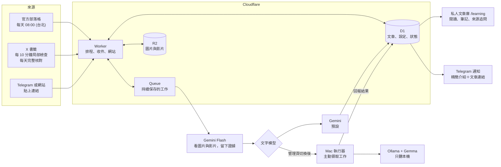

# TechNews

把開發者技術部落格和 X 上的技術貼文，整理成繁體中文的詳細文章，存進一個只有自己能讀的文章庫，並推送到 Telegram。

一個人要追的來源很多：官方部落格、X 書籤、朋友轉來的連結。這個專案讓它們走同一條流程。
來源進來後會自動抓全文、用模型寫成繁中整理、保存原文與媒體證據。你可以在文章庫閱讀、寫筆記，或針對來源提問。

整套系統跑在 Cloudflare Workers（免費方案可用）。文字整理可以改由自己 Mac 上的本機 Gemma 執行。

## 它怎麼運作



### 設計上的幾個取捨

| 取捨 | 做法 | 為什麼 |
| --- | --- | --- |
| 工作不能因為一次失敗就消失 | 文章與工作狀態寫進 D1，長工作交給 Queue；失敗留在待處理清單，下次繼續 | Worker 單次執行有時間限制，外部 API 也會暫時失敗 |
| 不偷偷截短或換便宜模型 | 全文超過上限就報錯留待重試；模型失敗不會自動改用付費 API；Mac 離線時工作等待，不改用雲端文字模型 | 讀者看到的整理必須對應完整原文，花費也必須是你主動選的 |
| 本機與雲端混合 | 只有 Mac 執行器對外連線去領工作；Ollama 只聽 `127.0.0.1` | 手機不用連回家裡，也不用開放家用網路的埠 |
| 文字模型可切換 | Gemini 與 Mac 本機 Gemma 使用同一份輸入格式，在管理頁切換，不需重新部署 | 方便用同一篇文章比較品質，也能自己決定花費 |
| 來源內容不是指令 | 來源夾帶的指令會被當成資料處理；驗收素材含 prompt injection 案例 | 抓進來的網頁與貼文不可信 |

## 我該讀哪份文件

| 我想要 | 讀這個 | 需要什麼 |
| --- | --- | --- |
| 先看畫面，不連外部服務 | [本機示範](docs/learning-setup.md#本機閱讀與操作示範) | Node.js 22.13+ |
| 部署文章庫，每天收到官方文章通知 | 本頁[快速開始](#快速開始) | Cloudflare 帳號、Telegram bot、Gemini API 金鑰 |
| 用 Telegram 分享連結、收 X 書籤 | [設定與使用](docs/learning-setup.md) | X 書籤另需 X 開發帳號 |
| 讓文字整理改由自己的 Mac 執行 | [Mac 執行器](cloud-digest/runner/README.md) | Apple Silicon Mac、Ollama |
| 對官方文章做語意問答 | 本頁[選用：RAG 問答服務](#選用rag-問答服務) | Python 3.12+、PostgreSQL + pgvector、OpenAI 金鑰 |
| 看系統怎麼設計 | [資料流與 input/output](docs/architecture.md) · [來源策略與 Worker／n8n 比較](docs/source-strategy.md) | — |
| 看實測結果 | [驗收紀錄](docs/testing/unified-learning-acceptance-2026-10-17.md) | — |

## 目前狀態

- **私人文章庫**：已部署並用真實貼文完成一輪驗證（收件、影片處理、教材生成、完成通知、單篇追問），見[實測紀錄](docs/testing/learning-setup-2026-10-13.md)。X 書籤同步預設關閉，要在管理頁主動開啟。
- **本機 Gemma**：14 組合成代表素材通過驗收，程式預設文字模型仍是 Gemini。要在代表素材驗收並啟動 Mac 執行器後，才到 `/learning/admin` 切換。
- **RAG 問答**：獨立的選用服務，沒有和 Worker 共用資料庫。

## 專案結構

| 目錄 | 用途 |
| --- | --- |
| [`cloud-digest/`](cloud-digest/) | Cloudflare Worker：排程、收件、文章庫網站、模型呼叫、Telegram 推送。**主要程式在這裡** |
| [`cloud-digest/runner/`](cloud-digest/runner/) | Mac 本機執行器與 launchd 常駐腳本 |
| [`app/`](app/) | 選用：FastAPI + pgvector 的 RAG 問答 |
| [`docs/`](docs/) | 架構、規格、實作計畫、驗收紀錄與調查報告，索引在[文件地圖](#文件地圖) |

---

## 快速開始

部署完成後，每天台北時間 08:00 開始檢查官方來源。新文章收進文章庫，由 Gemini 詳細整理，完成後在 Telegram 發一則精簡介紹與文章連結；沒有相關新文章時不發訊息。

> 想用 Telegram 分享連結、收 X 書籤或改用本機 Gemma，先完成這一節，再接著讀[設定與使用](docs/learning-setup.md)。

預設追蹤 OpenAI Developer Blog、OpenAI News、Apple Developer News、Claude Blog、claude.dev、Anthropic News 與 Engineering。入口與擷取方式見 [`cloud-digest/SOURCES.md`](cloud-digest/SOURCES.md)。

### 1. 建立 Telegram bot 與頻道

1. 在 Telegram 找 [@BotFather](https://t.me/BotFather)，傳送 `/newbot`，依指示命名後會拿到一組 **bot token**（格式類似 `123456789:AA...`）。
2. 建立一個頻道（公開或私人都可以），或使用現有頻道。
3. 進入頻道資訊 →「管理員」→ 新增管理員，搜尋你的 bot 加進去，並開啟「**發佈訊息**」權限。
   > 只在貼文中提及 `@你的bot` 並不會把它加入頻道，一定要加為管理員。

### 2. 取得頻道的 chat ID

- **公開頻道**：直接用 `@頻道帳號` 當作 chat ID，例如 `@my_dev_digest`。
- **私人頻道**：需要數字 ID（通常是 `-100` 開頭）。在 bot 成為管理員**之後**，先到頻道貼一則任意訊息，再執行：

  ```bash
  curl -s "https://api.telegram.org/bot<你的BOT_TOKEN>/getUpdates"
  ```

  在回傳的 JSON 中找 `"channel_post"` → `"chat"` → `"id"`，那串數字就是 chat ID。若結果是空的，再貼一則新訊息後重試。

> Bot token 等同密碼，不要提交到 git，也不要貼到公開場合。外洩時可到 @BotFather 用 `/revoke` 重新產生。

### 3. 安裝依賴並登入 Cloudflare

```bash
git clone https://github.com/stoola20/TechNews.git
cd TechNews/cloud-digest
npm install
npx wrangler login
```

### 4. 建立 Cloudflare 資源

`wrangler.jsonc` 宣告了 D1、R2 與 Queue，部署前三個都要先存在。

```bash
npx wrangler d1 create developer-digest-cloud
npx wrangler r2 bucket create technews-learning-media
npx wrangler queues create technews-learning-jobs
```

> R2 指令若問是否自動加入設定檔，選 `n`；設定檔已經有 `MEDIA` binding。

D1 指令會輸出一組 `database_id`。打開 [`cloud-digest/wrangler.jsonc`](cloud-digest/wrangler.jsonc)，把 `d1_databases[0].database_id` **換成你自己的 ID**（repo 內的是作者帳號的 ID，你的帳號無法使用）。

接著建立資料表：

```bash
npx wrangler d1 migrations apply developer-digest-cloud --remote
```

### 5. 設定 secrets

```bash
npx wrangler secret put TELEGRAM_BOT_TOKEN
npx wrangler secret put TELEGRAM_CHAT_ID
npx wrangler secret put RUN_TOKEN
npx wrangler secret put GEMINI_API_KEY
npx wrangler secret put PUBLIC_BASE_URL
```

每個指令執行後，依提示貼上對應的值：

| Secret | 值 |
| --- | --- |
| `TELEGRAM_BOT_TOKEN` | 步驟 1 拿到的 bot token |
| `TELEGRAM_CHAT_ID` | 步驟 2 的 `@頻道帳號` 或數字 ID |
| `RUN_TOKEN` | 自訂的隨機字串，登入文章庫與管理頁時使用，可用 `openssl rand -base64 32` 產生 |
| `GEMINI_API_KEY` | Gemini API 金鑰，用來詳細整理文章與解析圖片、影片 |
| `PUBLIC_BASE_URL` | Worker 的 HTTPS 網址（例如 `https://developer-digest-cloud.<你的子網域>.workers.dev`），通知裡的文章連結會用它 |

請保存自己設定的 RUN_TOKEN。若存成本機 `.cloud-run-token`，此檔案已由 `.gitignore` 排除。
`.env*`、`.dev.vars*`、Wrangler 本機狀態與資料庫檔也不會提交；只有空白或示範值的環境設定範例會保留。

### 6. 部署

```bash
npx wrangler deploy
```

部署完成後會顯示 Worker 網址。Cron 為每天 `00:00 UTC`（台北時間 08:00）開始檢查官方來源；08:00 是開始時間，完成時間取決於文章數量與模型速度。各 Cron 對應的任務見 `cloud-digest/src/schedule.js`。

### 7. 確認可以運作

開啟 `https://<Worker 網址>/learning`，用 RUN_TOKEN 登入，貼上一篇官方文章連結並按「加入文章庫」。整理完成後，Telegram 會收到通知。

官方來源**只收發表 7 天內的文章**（`MAX_ARTICLE_AGE_DAYS`），新來源首次執行也只回補這段期間；沒有日期時只處理列表第一篇。擷取失敗時不使用 RSS 簡介代替全文。

新增 D1 遷移後，部署前先執行 `npx wrangler d1 migrations apply developer-digest-cloud --remote`。只測本機時使用 `--local`。

### Worker 提供的端點

| 端點 | 驗證 | 說明 |
| --- | --- | --- |
| `GET /health` | 不需要 | 健康檢查 |
| `GET /learning`、`GET /learning/admin` | 登入 session | 文章庫（列表／閱讀）與管理入口 |
| `POST /learning/telegram` | Telegram webhook secret | Telegram 分享收件，設定見[設定與使用](docs/learning-setup.md#telegram-收件與通知) |
| `POST /learning/runner/{claim,heartbeat,complete,fail,release}` | `Authorization: Bearer <LEARNING_RUNNER_TOKEN>` | Mac 執行器專用；網站登入憑證不能使用 |

其他路徑一律回 404。

### 自訂

- **修改推送時間**：編輯 `wrangler.jsonc` 的 `triggers.crons`（UTC 時間），再重新 `npx wrangler deploy`。
- **新增或移除來源、調整想收到的內容**：設定存在 D1 的 `settings` 表，格式見 [`SOURCES.md`](cloud-digest/SOURCES.md)；特殊網站可指定 `contentSelector`，仍需確認能完整擷取。
- **切換文字模型**：在 `/learning/admin` 切換 Gemini 或本機 Gemma。
- **查看執行紀錄**：`npx wrangler tail`，或到 Cloudflare Dashboard → Workers → Observability。

### 執行測試

```bash
cd cloud-digest
npm test
```

測試使用 Node 內建 SQLite 套用全部 migration，外部網路與時間都以模擬取代，不需要任何金鑰。

---

## 選用：RAG 問答服務

用 FastAPI 提供 `/ingest`（匯入 OpenAI Developer Blog 文章並產生向量）與 `/ask`（語意檢索後由 LLM 回答並附引用）。只要 Telegram 摘要或文章庫的話，不需要這部分。

### 需求

- Python 3.12+ 與 `uv`
- PostgreSQL + [pgvector](https://github.com/pgvector/pgvector)（以下用 Docker 示範；macOS 也可以用 [Apple Container](https://github.com/apple/container)，指令幾乎相同，把 `docker` 換成 `container`）
- OpenAI API 金鑰

### 設定與啟動

```bash
cp .env.example .env        # 填入 OPENAI_API_KEY
cp .db.env.example .db.env
uv sync --extra test

docker volume create developer-kb-pgdata
docker run --detach --name developer-kb-db \
  --env-file .db.env \
  --publish 127.0.0.1:5432:5432 \
  --volume developer-kb-pgdata:/var/lib/postgresql/data \
  pgvector/pgvector:pg17

uv run alembic upgrade head
uv run uvicorn app.main:app --reload --host 127.0.0.1 --port 8000
```

範例設定使用僅供本機開發的資料庫帳密。若修改 `.db.env` 的 `POSTGRES_PASSWORD`，也要同步修改 `.env` 中 `DATABASE_URL` 的密碼。

### 使用

```bash
# 匯入文章（會呼叫 OpenAI 產生向量，有 API 費用）
curl -X POST http://127.0.0.1:8000/ingest

# 列出已匯入的文章
curl http://127.0.0.1:8000/articles

# 提問
curl -X POST http://127.0.0.1:8000/ask \
  -H 'Content-Type: application/json' \
  -d '{"question":"OpenAI 最近對 Codex 做了哪些改動？"}'
```

`/ask` 回傳 `answer` 與 `sources`（標題、原文網址、片段位置、相似度）。API 文件在 http://127.0.0.1:8000/docs 。

### 運作方式

發現文章網址 → 擷取內文 → 計算內容雜湊（未變動則略過）→ 切片（預設約 800 token、重疊 120）→ 產生 embedding → 存入 PostgreSQL。提問時以 pgvector 餘弦相似度取前 `RAG_TOP_K` 個片段，交給模型回答並標註引用；資訊不足時會回覆無法確認。

可調整的設定見 [`.env.example`](.env.example)。變更 `EMBEDDING_DIMENSIONS` 需要資料庫遷移；更換 embedding 模型則要重新產生所有片段的向量。

### 測試

```bash
uv run pytest -q
```

Python 測試會模擬外部網站與 OpenAI 回應，不需要真實的 API 金鑰。
首次執行切片測試需要下載 tiktoken 的公開分詞資料，之後會使用本機快取。

> 這是給個人本機使用的服務，沒有身分驗證，請讓 API 與資料庫只監聽 `127.0.0.1`。

---

## 文件地圖

| 類別 | 文件 | 內容 |
| --- | --- | --- |
| 架構 | [architecture.md](docs/architecture.md) | 資料流、各平台責任、input/output |
| 架構 | [source-strategy.md](docs/source-strategy.md) | 官方來源範圍、Workers AI 用量、Worker 與 n8n 比較 |
| 操作 | [learning-setup.md](docs/learning-setup.md) | 文章庫：Cloudflare 資源、Gemini、X、Telegram 收件、費用與故障處理 |
| 操作 | [runner/README.md](cloud-digest/runner/README.md) | Mac 本機文字執行器 |
| 操作 | [SOURCES.md](cloud-digest/SOURCES.md) | 官方來源的入口與擷取方式 |
| 規格 | [x-learning](docs/specs/x-learning.md) · [unified-learning](docs/specs/unified-learning.md) · [source-merging](docs/specs/source-merging-and-reading.md) · [library-topics-timeline](docs/specs/library-topics-timeline.md) | 需求與使用情境 |
| 計畫 | [x-learning](docs/plans/x-learning.md) · [unified-learning](docs/plans/unified-learning.md) | 實作順序與阻擋關係 |
| 驗收 | [docs/testing/](docs/testing/) | 測試證據與實測紀錄，區分模擬與真實 API |
| 調查 | [docs/research/](docs/research/) | X 收藏工具 survey、影片處理比較；價格與能力採用前須重新查核 |
| 設計稿 | [docs/previews/](docs/previews/) | 文章庫介面的 A／B 比較稿 |
| 流程 | [work-tracking.md](docs/agents/work-tracking.md) | 以本機 Markdown 管理規格與 tickets |

## 授權

[MIT](LICENSE)
