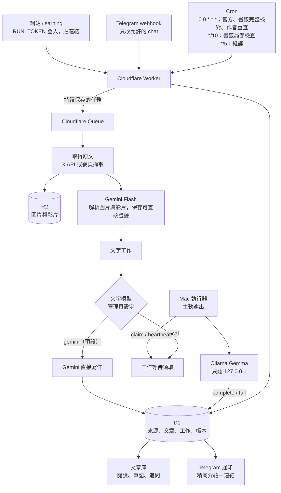

# TechNews 架構

這份文件描述目前 Worker 的架構。官方文章、X 書籤、Telegram 與網站分享都走同一個文章庫流程。
說明採用 [SimpleEnglish](https://github.com/AminBlg/SimpleEnglish/blob/main/skills/simple-english/SKILL.md) 的短句與明確主詞原則。

## 私人文章庫

官方文章、X 書籤、Telegram 與網站分享進同一個文章庫，共用來源身分、工作狀態、搜尋、筆記與來源追問。規格見 [統一整理規格](specs/unified-learning.md)，設定見 [設定與使用](learning-setup.md)。

| 平台 | 責任 |
| --- | --- |
| Worker | 排程、收件、登入、網站、Queue 消費、費用帳本、執行器工作領取 API |
| Queue | 喚醒持續保存的任務，單次處理一個訊息 |
| R2 | 保存圖片與影片，供證據解析與閱讀頁播放 |
| Gemini Flash | 只負責理解圖片與影片，保存證據；預設也負責文字寫作 |
| Mac 執行器 | 主動領取文字工作，呼叫本機 Ollama，回報結果。細節見 [runner/README.md](../cloud-digest/runner/README.md) |
| D1 | 保存來源、文章、筆記版本、工作狀態、通知狀態與費用帳本 |

兩個行為決定了工作會不會消失或被誤用：

- 切到 `local` 後，Mac 離線時工作保持「等待本機」，不會自動改用雲端文字模型。
- 執行器使用 `LEARNING_RUNNER_TOKEN`，與網站的 `RUN_TOKEN` 分開。網站登入憑證不能呼叫執行器端點。

## 官方文章擷取

claude.dev 使用官方 Markdown。其他來源擷取文章頁的正文、程式碼文字、表格文字與連結；直接請求失敗時改用 Browser Run。
程式不把 RSS description 當全文。超過 `MAX_ARTICLE_CHARS`（150,000 字串單位）的文章會報錯並留待重試，不會偷偷截斷。

「全文」指本次擷取的文章正文。官方文章的圖片像素、影片、下載檔、互動圖表、付費內容與外連文件不會自動交給模型。
程式不能證明網站沒有隱藏、分頁或動態載入的內容，也不能保證模型每個細節都理解正確。

## 與 RAG 服務的關係

選用的 Python RAG 問答服務仍獨立運作，沒有同步這個 D1 資料庫。

官方來源範圍、Workers AI 用量及 Worker／n8n 比較見 [來源策略與平台選擇](source-strategy.md)。
