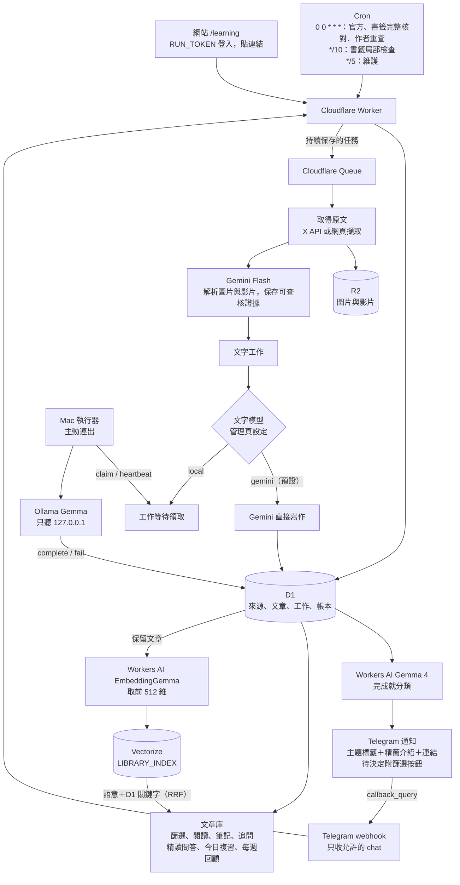
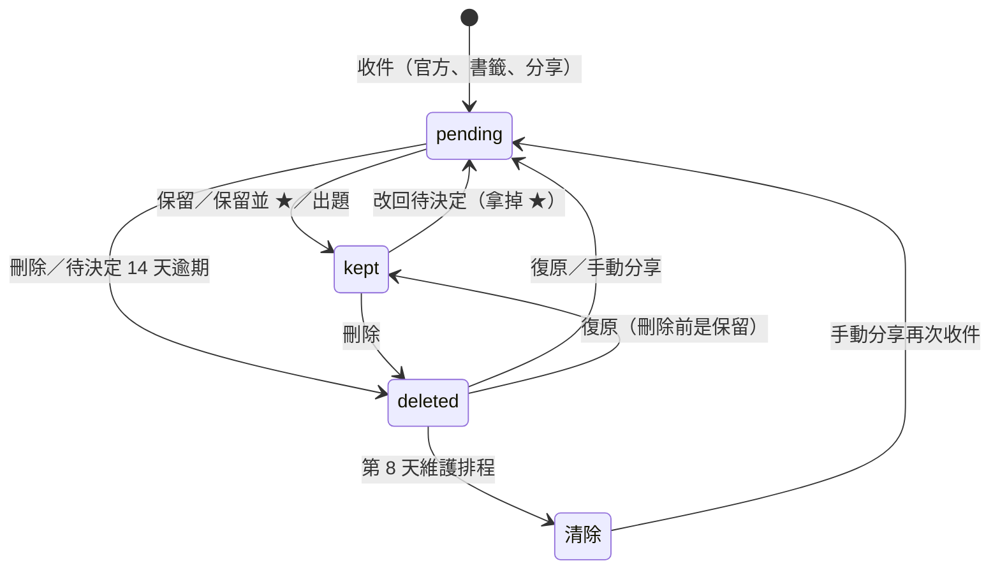
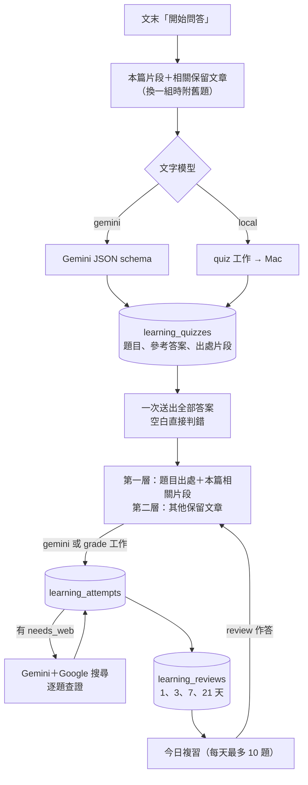

# TechNews 架構

這份文件描述目前 Worker 的架構。官方文章、X 書籤、Telegram 與網站分享都走同一個文章庫流程。
說明採用 [SimpleEnglish](https://github.com/AminBlg/SimpleEnglish/blob/main/skills/simple-english/SKILL.md) 的短句與明確主詞原則。

## 私人文章庫

官方文章、X 書籤、Telegram 與網站分享進同一個文章庫，共用來源身分、工作狀態、搜尋、筆記與來源追問。規格見 [統一整理規格](specs/unified-learning.md)，設定見 [設定與使用](learning-setup.md)。

| 平台 | 責任 |
| --- | --- |
| Worker | 排程、收件、登入、網站、Queue 消費、費用帳本、執行器工作領取 API |
| Queue | 喚醒持續保存的任務，單次處理一個訊息 |
| R2 | 保存圖片與影片，供證據解析與閱讀頁播放 |
| Gemini Flash | 只負責理解圖片與影片，保存證據；預設也負責文字寫作 |
| Mac 執行器 | 主動領取文字工作，呼叫本機 Ollama，回報結果。細節見 [runner/README.md](../cloud-digest/runner/README.md) |
| D1 | 保存來源、文章、筆記版本、工作狀態、通知狀態與費用帳本 |
| Workers AI | 用 Gemma 4 為完成的文章分主題；用 EmbeddingGemma 為保留文章產生向量。都不記入預算，但共用帳號的每日免費額度 |
| Vectorize | 只存保留文章片段的向量（512 維、cosine）；片段文字與位置在 D1 `learning_chunks` |

兩個行為決定了工作會不會消失或被誤用：

- 切到 `local` 後，Mac 離線時工作保持「等待本機」，不會自動改用雲端文字模型。
- 執行器使用 `LEARNING_RUNNER_TOKEN`，與網站的 `RUN_TOKEN` 分開。網站登入憑證不能呼叫執行器端點。

## 分類時機

文章寫成已完成或部分完成後，同一個處理流程立刻分類，再建立通知。Gemini 寫作在處理工作內分類；Mac 執行器回報完成時，Worker 在回應後的背景工作裡先分類再送通知。分類失敗不擋通知：通知照常發出、不附主題，失敗次數與延後時間記在文章上。

每 5 分鐘的維護排程仍有分類步驟，只處理重試到期的文章、「重新分類全部」排入的文章，以及尚未分類的既有文章。手動設定的主題不會被自動分類覆寫。

## 篩選結果與最近刪除

每篇文章除了處理狀態（`status`），還有一個篩選結果（`triage`）：`pending` 待決定、`kept` 保留、`deleted` 最近刪除，★（`starred`）只出現在保留文章上。主題不符、已合併與已清除的文章不參與篩選。

- 待決定期限從第一次可以閱讀（完成整理或進入等待確認回補）時起算 14 天，之後的重寫不重設；升級時已可閱讀的文章標記不過期。
- 清除時刪掉正文、來源、媒體與 R2 物件、筆記、追問、版本、題目、作答、複習、索引片段與尚未送出的通知，文章列改為 `dismissed`，只留網址、刪除時間與原因。書籤同步與官方來源看到這個網址不再收件；手動分享會重新收件。
- 最近刪除與已清除的文章不建立通知；已排入的通知在送出前再確認一次，略過的標為 `skipped`。
- Telegram 完成通知送出時，文章仍是待決定才附「保留」「保留並 ★」「刪除」。按下後 webhook 收到 `callback_query`，套用同一套篩選動作，按鈕換成結果與「復原」；復原回到第一次按下前的結果，記在那則通知的 `triage_undo`。

## RAG 索引與檢索

只有保留文章進索引。教材正文依標題與段落切成約 600–1,000 字，原始來源（主要與外部）約 1,000–1,500 字，媒體解析每則一段；筆記、追問與作答不收錄。文件端文字是 `title: <標題> | text: <片段>`，查詢端加上 `task: search result | query: `。

檢索寫在 `retrieval.js`，對外只有 `search`：語意排名（Vectorize 前 30 筆、相似度門檻 0.42）與 D1 關鍵字排名（限定保留文章，保留 API 名稱與版本號這類精確詞）用 RRF 合併，每份排名貢獻 1／(10＋名次)，每篇最多 3 段、取前 12 段。範圍 `all` 再用關鍵字補上待決定文章，排在保留之後。Workers AI 或 Vectorize 失敗時只用關鍵字，結果標示降級。之後換成 Mac 本機檢索時只替換這個模組。

| 使用位置 | 範圍 | 降級時 |
| --- | --- | --- |
| 全庫追問 | 保留；勾「也查未保留」時加上待決定 | 只比對關鍵字並標示 |
| 篩選卡片的相似文章 | 保留，門檻 0.55，前 3 篇 | 不顯示 |
| 出題的相關文章（連結題） | 保留，排除本篇，門檻 0.5，前 2 篇 | 不出連結題 |
| 批改的第二層證據 | 其他保留文章，最多 6 段 | 只用本篇證據 |

## 精讀問答、批改與複習

- 出題與批改的提示詞、輸出格式與驗證放在 `quiz-prompt.js`，Worker 與 Mac 執行器共用。Gemini 用 JSON schema；本機用區段標記，解析後交給同一個驗證函式。驗證不通過時不寫入，可以重試。
- 題目保存出處片段的內容；文章之後更新，批改仍用出題時的證據，畫面標示「文章已更新」。
- 網路查證只處理第一輪標記 `needs_web` 的題目，搜尋次數取自 grounding metadata 的 `webSearchQueries`。本機批改完成後，由 Worker 在回應執行器之後的背景工作查證；卡住超過 10 分鐘的查證由維護排程重試。
- 複習階梯：答對且確定往上一階（第 4 階答對就完成），部分正確留在同一階，答錯或不確定回到第 1 階、明天再來。「今天」依台灣日期。文章不是保留時，複習題不出現。

## 維護排程

每 5 分鐘的維護排程只做需要定期做的事：

- 重新排入失敗或卡住的工作、到期的分類重試。
- 篩選：補上待決定期限的起算點、逾期移到最近刪除、清除刪除超過 7 天的文章（每輪最多 50 篇與 20 篇）。
- RAG 索引：移出非保留文章、建立或更新最多 3 篇保留文章，失敗延後重試，連續 5 次後停止。
- 重新查證卡住的網路查證（每輪最多 3 筆）。
- 補送已保存的文章通知、來源提醒與 Telegram 收件回覆。
- 清理過期的媒體與登入 session；書籤同步啟用時續跑完整核對。
- 清理 30 天前的官方來源執行紀錄與已不在列表上的網址條目。

一次性的舊資料整理（搬移舊官方導讀、合併既有重複、回補發表時間、清掉裝飾圖片造成的缺漏）不在排程裡，改由管理頁「維運」按鈕一次執行，回傳各項筆數，可重複執行。

## 官方來源紀錄

官方發現每次執行，每個來源寫一筆執行紀錄（找到、收件、太舊略過、初次基準、成功或失敗與原因）。列表上的每個網址各記一列決策：

| 決策 | 意思 |
| --- | --- |
| 初次基準 | 新來源第一次執行前就已在列表上，不收件；超過 30 天沒有成功檢查（關閉或故障）的來源重新開始時也重新建立基準 |
| 收件 | 收進文章庫，連到對應文章；管理頁按「仍要收件」的標為手動，之後不會被改回太舊 |
| 太舊略過 | 發表超過 `MAX_ARTICLE_AGE_DAYS` 天；列表上有日期時在發現時判斷，沒有日期時抓到原文後判斷 |

關閉的來源不發現、不寫執行紀錄。同一來源連續失敗的次數從執行紀錄往回數，剛好第二次時建立一則來源提醒（類型與文章通知分開，不帶文章），第三次以後不重發；成功一次就中斷計數。管理頁「官方來源」區塊讀取這兩份紀錄，也在同一區塊保存想收到的內容與來源清單（D1 `settings` 表的 `digest`）。執行紀錄保留 30 天；網址條目在 30 天內都沒再出現在列表時才清除，仍在列表上的網址不會被當成沒看過。

## 官方文章擷取

claude.dev 使用官方 Markdown。其他來源擷取文章頁的正文、程式碼文字、表格文字與連結；直接請求失敗時改用 Browser Run。
程式不把 RSS description 當全文。超過 `MAX_ARTICLE_CHARS`（150,000 字串單位）的文章會報錯並留待重試，不會偷偷截斷。

「全文」指本次擷取的文章正文。官方文章的圖片像素、影片、下載檔、互動圖表、付費內容與外連文件不會自動交給模型。
程式不能證明網站沒有隱藏、分頁或動態載入的內容，也不能保證模型每個細節都理解正確。

官方來源範圍、Workers AI 用量及 Worker／n8n 比較見 [來源策略與平台選擇](source-strategy.md)。
